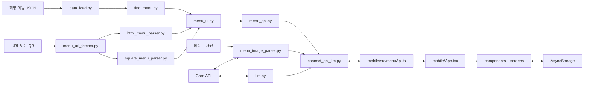

# menu-helper V1 파일 안내

이 문서는 V1을 코드 리뷰할 때 각 파일의 역할과 사용 기술을 빠르게 확인하기 위한 요약입니다.

## 백엔드 파일

| 파일 | 무엇을 위한 파일인가? | 주요 라이브러리·기술 |
|---|---|---|
| `app_config.py` | 루트 `.env`에서 데이터 경로, API 주소, Groq 설정을 한곳에 모읍니다. | Python 표준 라이브러리, `python-dotenv` |
| `data_load.py` | 메뉴 JSON을 UTF-8로 읽고 기본 구조를 검사합니다. | Python `json`, `pathlib` |
| `find_menu.py` | 전체 메뉴 목록을 반환하거나 `item_id`로 메뉴 하나를 찾습니다. | Python 표준 라이브러리 |
| `menu_ui.py` | 원본 메뉴를 음식·음료 목록 카드와 상세 화면용 공통 구조로 바꿉니다. | Python 표준 라이브러리 |
| `html_menu_parser.py` | 지원 HTML과 JSON-LD에서 메뉴를 공통 구조로 추출합니다. | Python `HTMLParser`, `json`, 정규식 |
| `square_menu_parser.py` | Square 상품·카테고리·가격·옵션·이미지를 공통 구조로 변환합니다. | Python 표준 라이브러리 |
| `menu_url_fetcher.py` | URL과 목적지 IP를 검사하고 웹페이지/Square 공개 데이터를 가져옵니다. | Python `urllib`, `socket`, `ipaddress` |
| `menu_api.py` | 저장 JSON과 URL 메뉴의 목록·상세 HTTP API를 제공합니다. | FastAPI, Pydantic |
| `llm.py` | 메뉴 한 건과 선택 옵션을 Groq에 보내 한국어 설명을 생성합니다. ID는 서버가 결합합니다. | Groq Python SDK, JSON Schema |
| `menu_image_parser.py` | 메뉴판 사진을 검사하고 Groq Vision 결과를 공통 메뉴 구조로 바꿉니다. | Groq Python SDK, `base64`, `hashlib` |
| `connect_api_llm.py` | 메뉴 API, 설명 API, 사진 API를 하나의 V1 FastAPI 앱으로 합칩니다. | FastAPI, Pydantic, Groq SDK, Uvicorn |
| `scripts/generate_menu_qr.py` | 테스트할 메뉴 URL을 QR 이미지로 만듭니다. | `qrcode`, Pillow |

## 모바일 파일

| 파일 | 무엇을 위한 파일인가? | 주요 라이브러리·기술 |
|---|---|---|
| `mobile/index.ts` | Expo 앱의 시작점으로 `App`을 등록합니다. | Expo |
| `mobile/App.tsx` | URL·QR·사진 입력, 메뉴 탭, 화면 이동을 관리하는 최상위 화면입니다. | React, React Native, Expo |
| `mobile/src/menuApi.ts` | FastAPI 호출, 설명 캐시 확인, 같은 요청의 중복 호출 방지를 담당합니다. | TypeScript, Fetch API |
| `mobile/src/menuTypes.ts` | 메뉴·옵션·설명·저장 데이터의 TypeScript 타입을 모읍니다. | TypeScript |
| `mobile/src/components/MenuSourcePanel.tsx` | URL 입력, 붙여넣기, QR·사진 진입 버튼을 보여줍니다. | React Native, `expo-clipboard` |
| `mobile/src/components/MenuCardView.tsx` | 목록에서 메뉴명·가격·원문 설명·옵션 상태를 보여줍니다. | React Native |
| `mobile/src/components/QRScannerModal.tsx` | 카메라 권한을 요청하고 QR 링크를 읽습니다. | `expo-camera`, React Native |
| `mobile/src/components/MenuPhotoModal.tsx` | 카메라 촬영 또는 사진 보관함 선택을 처리합니다. | `expo-image-picker`, React Native |
| `mobile/src/components/MenuImageGallery.tsx` | 대표 이미지와 추가 이미지를 보여줍니다. | React, React Native |
| `mobile/src/components/OptionGroupView.tsx` | 실제 메뉴 옵션 그룹과 선택지를 표시합니다. | React Native |
| `mobile/src/screens/MenuDetailScreen.tsx` | 상세·옵션 선택·가격·저장·Groq 설명을 연결합니다. | React, React Native |
| `mobile/src/screens/SavedMenuScreen.tsx` | 기기에 저장한 메뉴 조합을 조회하고 삭제합니다. | React, React Native |
| `mobile/src/storage/savedMenus.ts` | 선택 메뉴와 생성 설명을 기기 안에 저장하고 읽습니다. | AsyncStorage |
| `mobile/src/utils/menuSelection.ts` | 옵션 기본값, 선택 토글, 최소·최대 선택 제한을 계산합니다. | TypeScript |
| `mobile/src/utils/menuPrice.ts` | 변형 가격과 확인된 추가 요금을 계산합니다. | TypeScript |

## 설정·데이터·테스트 파일

| 파일 | 무엇을 위한 파일인가? | 주요 라이브러리·기술 |
|---|---|---|
| `.env.example` | 백엔드 환경변수 예시입니다. 실제 API 키는 `.env`에만 둡니다. | dotenv 형식 |
| `requirements.txt` | 백엔드 실행 패키지와 버전을 고정합니다. | FastAPI, Groq, python-dotenv, Uvicorn |
| `requirements-dev.txt` | QR 생성 등 개발 도구 패키지를 추가합니다. | qrcode, Pillow |
| `fixtures/demo_cafe_menu.html` | HTML 추출기를 안전하게 연습하는 로컬 샘플입니다. | HTML |
| `tests/test_html_menu_parser.py` | HTML/JSON-LD 메뉴 변환을 확인합니다. | `unittest` |
| `tests/test_square_menu_parser.py` | Square 목록·상세·옵션·이미지 변환을 확인합니다. | `unittest` |
| `tests/test_menu_url_fetcher.py` | URL 보안 검사와 Square 요청 연결을 확인합니다. | `unittest`, mock |
| `tests/test_menu_ui.py` | 목록 탭·카테고리·옵션 요약 변환을 확인합니다. | `unittest` |
| `tests/test_menu_detail.py` | 상세 옵션 상태와 기존 데이터 호환성을 확인합니다. | `unittest` |
| `tests/test_llm_selection.py` | 선택 ID 검증과 서버의 안전한 ID 결합을 확인합니다. | `unittest`, mock |
| `tests/test_menu_image_parser.py` | 이미지 형식·크기와 OCR 공통 구조 변환을 확인합니다. | `unittest`, mock |
| `mobile/package.json` | 모바일 패키지, Expo 명령, TypeScript 검사를 정의합니다. | npm, Expo |
| `mobile/package-lock.json` | 실제 설치되는 npm 의존성 버전을 잠급니다. | npm |
| `mobile/app.json` | 앱 이름, 카메라·사진 권한과 iOS/Android 설정을 정의합니다. | Expo config |
| `mobile/eas.json` | Expo Development build 설정을 정의합니다. | EAS Build |
| `mobile/tsconfig.json` | TypeScript 검사 규칙을 설정합니다. | TypeScript |
| `mobile/.env.example` | 모바일이 접속할 FastAPI 주소 예시입니다. | Expo 환경변수 |
| `mobile/assets/*` | 앱 아이콘과 시작 화면 이미지를 보관합니다. | PNG 이미지 |
| `README.md`, `mobile/README.md` | 프로젝트 전체와 모바일 실행 방법을 설명합니다. | Markdown |

## 주요 프레임워크와 라이브러리

- 백엔드: Python, FastAPI, Pydantic, Uvicorn
- AI: Groq Python SDK와 JSON Schema structured output
- 모바일: Expo, React, React Native, TypeScript
- 기기 기능: expo-camera, expo-image-picker, expo-clipboard, AsyncStorage
- 테스트: Python unittest, TypeScript `tsc --noEmit`, Expo Doctor
- 데이터 읽기·웹 요청: Python 표준 라이브러리 `json`, `pathlib`, `urllib`, `socket`

## 파일 연결 관계

다운로드용 다이어그램: [menu-helper-v1-flow.svg](./menu-helper-v1-flow.svg)

